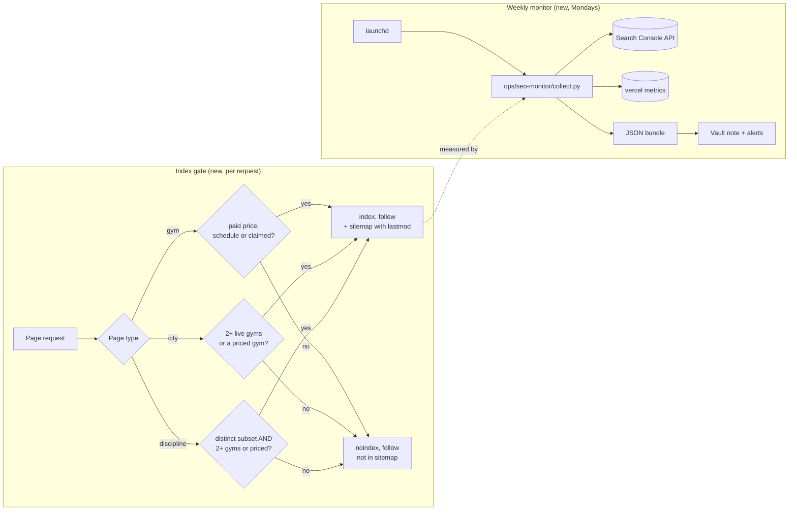

# SEO index gate, sitemap lastmod, and weekly search monitor

Revision: v3 (approved 2026-11-01: trial alone does not qualify)
Status: Approved (G1) by Vinh 2026-11-01, including production migrations 0007/0008 and local weekly monitor installation
Project / repository: fightgyms (github.com/vnguyendc/fightgyms)
Strategy: vault `SEO Reports/FightGyms SEO Strategy 2026-10-29.md` and `... Implementation Roadmap 2026-10-29.md`, Phase 1
PR target: `master`
Workspace: `.claude/worktrees/seo-index-gate-monitor`, branch `worktree-seo-index-gate-monitor`, base `3370fc8`

## Problem statement

Google search impressions for findfightgyms.com fell from 140–598 a day (Sep 27–Oct 7) to 0–10 a day from 2026-10-13. Sampled gym pages moved to "Crawled – currently not indexed". The likely cause (inferred) is that most of the 477 sitemap URLs are thin: of 156 live-style city pages, 99 list one gym and no priced gym, and 135 of 267 live gym pages have no paid price, schedule or claim. Nothing tells Google which pages are worth indexing, and nothing tells us when search numbers move: the last look was manual, 16 days after the drop.

A blocker sits in front of all of it (verified 2026-10-29). Production still serves the 2026-09-28 build. The Oct 8 production build of PR #14 failed while prerendering `/gym/[slug]`, because the app reads `gyms.owner_updated_at` and production has not had `0007_owner_edits.sql` applied (`column g.owner_updated_at does not exist`). Until 0007 is applied, no merge to master can deploy, including this one.

## Proposed solution overview

The approved scope is one PR plus the explicitly authorized production schema updates and local monitor installation.

1. **Index gate.** A pure function decides whether each city, discipline and gym page carries enough unique facts to be indexed. Pages that fail keep rendering normally and stay linked, but get `noindex, follow` and drop out of the sitemap. No visible UI change.
2. **Sitemap lastmod.** Migration `0008` exposes a `last_verified_at` date on `gym_cards`. The sitemap uses it for gym pages, and the newest of a page's gyms for city and discipline pages. If the column is missing, the app leaves `lastmod` out and still builds.
3. **Weekly search monitor.** A repo script collects Search Console (performance, sitemap, a fixed URL Inspection sample) and Vercel Web Analytics/Speed Insights, writes a JSON bundle plus a dated vault note with alerts, and posts a macOS notification. A launchd agent runs it every Monday. A project skill lets any Claude session run it on demand and interpret the bundle.
4. **Approved prerequisite:** apply `0007_owner_edits.sql`, then `0008`, to production, following `docs/launch-operations.md`.

## Visual overview

Caption: today every page is `index, follow` and in the sitemap. After the change only pages with a fact the gym's own site does not summarize are offered to Google, and the monitor shows each week whether those pages are getting indexed.

## Context, research, and triage

- Classification: SEO feature (index gate, lastmod) plus ops tooling (monitor). Urgency high: search visibility is near zero and every week without a gate is another crawl of thin pages. The 0007 blocker is a release defect (P1 for delivery, no user-facing outage, because production still serves the Sep 28 build).
- Inspected: `web/src/lib/site.ts` (`directorySitemap`, `pageMetadata`, `distinctStyleListing`), `web/src/app/sitemap.ts`, the city, discipline and gym routes, `web/src/lib/data.ts` (selects `*` from `gym_cards`, so a new column is additive), `supabase/migrations/0003_gym_cards_v3.sql` (current view), `0007_owner_edits.sql`, `web/tests/sitemap.test.ts`, the Vercel build log for `fightgyms-qqo3wtwcs` (Oct 8, failed), `vercel ls --prod`.
- Gate counts, live database 2026-10-29, live styles only:

  | Rule | Pass | Of |
  |---|---|---|
  | Gym: paid price, schedule or claimed (recommended) | 132 | 267 |
  | Gym: the same, or a free trial | 167 | 267 |
  | City: 2+ live gyms or a gym with a paid price (recommended) | 57 | 156 |
  | City: 2+ live gyms or any price including trial | 91 | 156 |

  Expected sitemap after the gate: roughly 132 gyms + 57 cities + distinct discipline pages + home, `/gyms`, `/gyms/all` pages, about 210–230 URLs with D1 (exact count measured at verification).
- Monitor research: `vercel metrics vercel.analytics_pageview.count --project fightgyms --scope vinh-nguyens-projects-4454b12d` returns daily page views (verified: 415 since Sep 26, mostly Sep 27–28) and supports `--group-by referrer_hostname,request_path`; `vercel.speed_insights.lcp_ms` exists. The GA4 account visible to the service account has no findfightgyms property, so GA4 is out. Search Console works through the service account at `~/.config/claude-seo/service-account.json` (read-only scope); system `python3` has `googleapiclient`. An existing launchd job (`com.vinh.weekly-seo-report`, Anna Health) gives the pattern: shell plus Python, validated JSON bundle, `osascript` notification.
- Assumptions: launchd runs as Vinh, so the Vercel CLI login and the service-account key are readable. A Vercel CLI token can expire; the monitor reports that as an alert and still writes the Search Console part.
- Exclusions: cost guides, city comparison tables, claim badge, outreach, Bing setup, Manual Actions check, any UI change, Google Ads. GA4. Changing how pages render.
- Decision D1 (Vinh, 2026-11-01): a free trial alone does not qualify a gym page. This supersedes the earlier trial-inclusive draft; expected 132 of 267 gym pages.

## Requirements and acceptance criteria

| ID | Requirement | Observable acceptance criterion |
|---|---|---|
| R1 | A gym page is indexable only if it has a paid monthly or drop-in price, at least one class row, or is claimed. | Unit tests cover each qualifying fact (trial-only fails) and a bare gym; on a production-mode build a bare gym page has `<meta name="robots" content="noindex, follow">`, a priced one `index, follow`; a trial-only one `noindex, follow`. |
| R2 | A city page is indexable only with 2+ live-style gyms or at least one gym with a paid price. | Unit tests; built single-gym unpriced city page shows `noindex, follow`. |
| R3 | A discipline page is indexable only if it is already a distinct subset (existing rule) and its gyms pass the R2 test. | Unit tests; redirect behaviour for non-distinct pages unchanged. |
| R4 | Non-indexable pages render exactly as before and keep `follow`. | Rendered HTML of a gated-out page differs from master only in the robots meta; links remain. |
| R5 | The sitemap lists only indexable pages. | `sitemap.test.ts` cases; built sitemap count matches the gate count from the database. |
| R6 | Sitemap entries carry `lastModified` from `last_verified_at` when present; listing pages use their newest gym's date; static pages have none; nothing uses "now". | Unit tests with and without the field; built sitemap shows `<lastmod>` on gyms with dates. |
| R7 | Migration 0008 adds `last_verified_at` to `gym_cards` without changing existing columns, and the app builds when the column is absent. | `migrations.test.ts` (PGlite) applies 0001–0008 and reads the column; build passes against a view without it. |
| R8 | Preview and unconfigured builds stay fully noindex (existing `runtimePolicy`). | Existing tests plus `npm run test:smoke` pass. |
| R9 | `ops/seo-monitor/collect.py` writes a dated JSON bundle with: Search Console daily clicks and impressions (last 28 days and the 28 before), top pages and queries for the last 7 days vs the prior 7, sitemap status, URL Inspection results for a fixed sample of 30 sitemap URLs, Vercel daily page views and top referrers, Speed Insights LCP p75. | Running it by hand produces the bundle; each source is either present or recorded as an error with its reason. |
| R10 | The run writes `SEO Reports/FightGyms SEO Weekly <date>.md` in the vault (numbers, a Mermaid chart, alerts, a link to the previous weekly note) and posts a macOS notification. | Note exists after a manual run and renders in Obsidian. |
| R11 | Alerts fire for: 7-day impressions down 50%+ vs the prior 7; any sampled URL leaving "Submitted and indexed"; sitemap errors > 0; sitemap not read in 14 days; homepage not 200; a data source failing. | Unit tests on the alert function with synthetic bundles. |
| R12 | A launchd agent runs the monitor weekly (Monday ~08:10 local) and can be installed or removed with one script. | `launchctl list` shows the agent; `launchctl kickstart` produces a new bundle and note. |
| R13 | A project skill (`.claude/skills/seo-check/SKILL.md`) tells a Claude session how to run the monitor on demand and read the bundle. | Skill lists in a new session; following it yields the same bundle. |
| R14 | No secrets in the repo or the bundle; the monitor is read-only toward Search Console, Vercel and the site. | Code review; the key path is read from `~/.config/claude-seo/google-api.json`. |

## Design

Index gate, all in `web/src/lib/site.ts`:

- `gymIndexable(g: GymCard)` and `listingIndexable(gyms: GymCard[])`, pure, next to `distinctStyleListing`. A free trial alone does not qualify (D1).
- `pageMetadata(path, title, description, hasContent, indexable = true)`: robots becomes `{ index: policy && hasContent && indexable, follow: policy && hasContent }`, so gated pages keep `follow` while unavailable/demo pages stay `noindex, nofollow`.
- Routes pass the flag: gym `generateMetadata` already has the card; city and discipline routes already load their gyms.
- `directorySitemap` filters with the same functions and sets `lastModified`.

Lastmod: `0008_gym_cards_last_verified.sql` uses `create or replace view gym_cards` (all existing columns in order, preserving grants) adding `last_verified_at = greatest(max(gym_prices.verified_at), max(classes.verified_at), gyms.owner_updated_at::date)`. It depends on 0007. `GymCard.last_verified_at?: string | null` is optional, so the app builds either way.

Monitor, `ops/seo-monitor/`:

- `collect.py` (system python3, stdlib + `googleapiclient`): `gsc_*` functions, `vercel_metrics()` that shells out to the CLI with JSON output, `inspect_sample()` (sorted sitemap URLs, every Nth until 10 gym pages, 10 city pages, 5 discipline pages, home, `/gyms`, plus the 3 pages with most historical impressions), `alerts(bundle, prior_bundle)`, `render_note()`. Output: `~/.local/share/fightgyms/seo-monitor/<date>/bundle.json`, the vault note, a notification. One source failing never stops the others.
- `run.sh` (launchd wrapper: PATH, log file), `com.vinh.fightgyms-seo-monitor.plist`, `install.sh` / `uninstall.sh`.
- `tests/test_alerts.py` with unittest, run by the existing `python -m unittest discover` command if placed under `scrapers/tests`; otherwise its own command documented in `ops/seo-monitor/README`. (I will follow the scrapers test location so the existing command covers it.)

Alternatives considered: a cloud routine (no access to the local key, vault or Vercel login), a session cron (dies with the session, 7-day cap), a headless `claude -p` run each week (costs tokens every week and harder to test). A deterministic script plus an on-demand skill gives repeatable numbers and keeps interpretation for when Vinh asks.

Risks: gating removes ~253 URLs from the sitemap at once (intended; pages remain reachable). A wrong gate input (e.g. `class_count` stale) hides a good page; the monitor's sample catches it. URL Inspection quota is 2,000/day per property; 30 a week is far under it.

## Task stewardship

No Linear issue (Linear is not connected for this project). After G1, at milestones: update the vault project page `01 Projects/FightGyms.md` (current status: deploy blocker, gate shipped, monitor live) and tick Phase 1 lines in `SEO Reports/FightGyms SEO Implementation Roadmap 2026-10-29.md`. The monitor creates its own weekly notes.

## Task breakdown

| Task | Requirements | Dependencies / likely files | Verification |
|---|---|---|---|
| 0. Apply 0007 then 0008 to production (explicitly approved 2026-11-01) | unblocks delivery | `docs/launch-operations.md`, `scrapers/run_sql.py` | `gym_cards.last_verified_at` and `gyms.owner_updated_at` exist; next master build Ready |
| 1. Gate functions and tests | R1–R3 | `web/src/lib/site.ts`, `web/tests/site.test.ts` | unit tests |
| 2. Wire gate into metadata and routes | R1–R4, R8 | gym, city, discipline routes | build + rendered HTML check |
| 3. Sitemap gating and lastmod | R5, R6 | `site.ts`, `web/src/lib/types.ts`, `web/tests/sitemap.test.ts` | unit tests, built sitemap |
| 4. Migration 0008 | R7 | `supabase/migrations/0008_gym_cards_last_verified.sql`, `web/tests/migrations.test.ts` | PGlite test |
| 5. Monitor collector, alerts, note | R9–R11, R14 | `ops/seo-monitor/collect.py`, `scrapers/tests/test_seo_monitor.py` | unittest + one real run |
| 6. launchd agent and install scripts | R12 | `ops/seo-monitor/run.sh`, plist, install/uninstall | `launchctl kickstart` run |
| 7. On-demand skill and docs | R13 | `.claude/skills/seo-check/SKILL.md`, `docs/launch-operations.md` SEO section | skill run |

## Validation and delivery

- Implementation checks: `cd web && npm test && npm run typecheck && npm run lint && npm run build && npm run test:smoke`; `python -m unittest discover -s scrapers/tests`.
- Behavioral checks: production-mode build against live data (`next start` with production env) and curl the robots meta on a bare gym, a priced gym, a single-gym city, a multi-gym city, a gated discipline page; count `<loc>` and `<lastmod>` in the built sitemap and compare with the database counts. One real monitor run, the vault note opened, the notification seen, `launchctl kickstart` run.
- Delivery: PR to `master`. CI (`web` check) and the Vercel preview build: the preview reads production Supabase, so **the preview build will fail like the Oct 8 build until task 0 is done**. G4 reports that explicitly if task 0 is still pending.
- Installing the launch agent writes `~/Library/LaunchAgents/com.vinh.fightgyms-seo-monitor.plist` on this Mac; G1 approval covers that install. Uninstall with `ops/seo-monitor/uninstall.sh`.
- After merge (not part of this authority): resubmit the sitemap in the Search Console UI.

## Approval record

Vinh approved 2026-11-01: “Approved. Apply 0007 and 0008, set up the weekly monitor, and implement the index gate. Free trial alone shouldn't qualify for indexing. Open a PR when it's ready.” This authorizes implementation, verification, production migrations 0007/0008, local monitor installation, and PR creation to master. Merge and application production release remain separate.

## Execution evidence · 2026-11-01

- G1 recovered from the explicit user message above; latest instruction excludes trial-only pages. The pre-existing uncommitted WP1 implementation was preserved and reviewed, then corrected to the approved rule. No separate reviewer agent was used.
- Production preflight matched scraper database and app Supabase configuration. Migration 0007 was already present (owner_updated_at, revision, owner-edit audit/function, replacement submissions policy); it was not rerun. Migration 0008 committed after local PGlite verification. View column prefix, row count and anon SELECT grant were preserved; PostgREST schema reload notified. This did not deploy the application.
- Implementation self-review: corrected the stale trial-inclusive rule, pinned launchd Python, excluded preview/provider-hostname analytics, preserved both apex and www production analytics, and bounded repeated URL Inspection failures. No remaining P0/P1 findings at this stage.
- Local supporting checks: 115 web tests and 94 Python tests pass; typecheck and lint pass. Live-data production build passes. Explicitly unconfigured production build and all smoke tests pass. The first smoke attempt used live build-time configuration and correctly failed the unavailable-state expectation; rerunning with explicit empty configuration passed.
- Real runtime, live directory: bare `/gym/octane-mma-monongahela-pa` and trial-only `/gym/deep-water-bjj-harrisburg-pa` return 200 with noindex, follow; priced `/gym/lombardmma-state-college-pa` and scheduled `/gym/urban-boxing-foggy-bottom-washington-dc` return index, follow. Stafford city is noindex; Damascus city is index. Damascus kickboxing and Kensington muay-thai are noindex; Fairfax muay-thai and Falls Church kickboxing are index. Gated pages retain links.
- Built sitemap: 224 URLs, 206 lastmod entries; same pure rules compute the expected total from production directory data. Gym gate passes 132/267. Static entries have no fabricated date. This gate is local/PR until merge and an authorized application production release.
- launchd agent installed at com.vinh.fightgyms-seo-monitor, Monday 08:10 Mac local time. Installed Python is the dependency-equipped Framework Python. On-demand collection and launchd run in progress; final monitor and hosted PR evidence follows below.

- Monitor end-to-end PASS: launchd-triggered collection finished with exit 0; all 12 source groups available, all 30 URL inspections returned, no configured alert fired. Bundle: `~/.local/share/fightgyms/seo-monitor/2026-11-01T183007065386Z/bundle.json`; vault report `SEO Reports/FightGyms SEO Weekly 2026-11-01.md` exists with the Mermaid chart and measured summaries. Vercel 28-day production apex/www: 102 page views; LCP p75 1004 ms. Notifications command completed successfully (onscreen notification display not independently observed). Search Console through Oct 29: report contains finalized daily data and seven-day comparisons. Unchanged alert sets stay quiet on later runs.
- Requirement-based verification R1–R14 passed for the local/runtime/ops scope, with no separate reviewer agent. The notification's actual onscreen display and fresh-session skill-menu discovery are not independently observed; the command, skill file, and documented on-demand execution are verified. PR preview verification remains delivery-stage work.
- PR delivery: https://github.com/vnguyendc/fightgyms/pull/16 targets master. Required checks: web and Vercel; scraper offline-tests also runs. Application behavior was verified at a5071d7; the follow-up documentation-only correction changes the source-group count from 13 to 12 and adds this delivery record, so its runtime evidence remains applicable. The weekly note's GUI opening via cmux was blocked because this Codex process was not launched inside cmux; report contents/chart syntax were verified, actual GUI rendering remains unobserved. The unrelated pre-existing traffic-growth-program plan remains untracked and excluded from this PR. No merge or application production deploy is authorized or performed.
