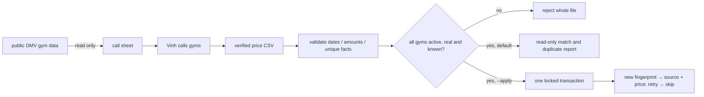

# phone-price import · WP2 implementation record

Revision: v1, implementation detail within approved traffic-growth program v1 WP2. G1: Vinh approved the program and WP1/WP2 implementation, verification and PRs to master on Oct 30 ("approved, and yes apply 0007 to production"). This record adds no scope or approval gate. Canonical program: `docs/superpowers/plans/2026-10-29-traffic-growth-program.md` in the `seo-index-gate-monitor` worktree; it is not yet in master. Workspace: `codex/phone-price-import`, base `3370fc8`; PR target `master`.

## problem and solution

The DMV phone sprint needs a way to enter confirmed prices without losing provenance or duplicating reruns. A Python CLI exports a call sheet and validates a price CSV; by default it performs only a read-only dry run. Explicit `--apply` appends a manual source and phone-verified price per fact in one transaction. No production price writes are authorized by this development approval.

## requirements, design and tasks

- WP2-R1 / G-R4: CSV prices append with `verified_by=phone`, USD cents, a manual `sources` row and the original normalized fact. Verify real SQL joins and free-trial representation on PGlite.
- WP2-R2 / G-R4: rerunning identical facts adds nothing; changed confirmations append without deleting history. Use a stable SHA-256 source fingerprint and transaction advisory lock; verify import/rerun/changed-price cases on PGlite.
- WP2-R3: invalid amounts/dates, empty CSVs, duplicate gym/kind/date rows and unknown/inactive/sample gyms fail before any write. Verify parser tests and whole-file preflight; apply locks matched gyms against concurrent deactivation.
- WP2-R4: default dry run and call-sheet export are database read-only. `DATABASE_URL` is required explicitly; `--apply` requires a reviewed real input. Verify dry-run command and public-data export against production, without an apply.
- WP2-R5 / G-R11: no invented real-gym prices. Fictional fixtures only in tests; real validation inputs reuse existing recorded values and are labeled validation-only. Filled call sheets stay outside Git.

Classification: feature plus operational documentation; normal risk for CLI code, higher risk for an actual production apply (separate authorization). No UI change. Reuse the existing append-only schema; no new migration or API. Scope excludes outreach sends, schedule editing, claims verification and real price imports.

Task sequence: parser/CSV contract → atomic importer/preflight → call-sheet export/runbook → Python and PGlite tests → read-only production dry run/export → self-review → runtime verification → PR. Existing repository checks remain required. Obsidian milestone update is covered by the canonical program; no new Linear issue requested.

## evidence

Implementation self-review: whole-file parser validation precedes DB work; unknown/inactive/sample gyms fail before writes; matched rows are locked during apply; source/price SQL is atomic; fingerprints make reruns idempotent. No unresolved P0/P1 findings. No separate reviewer used. No UI code changed.

Runtime verification Nov 1: a production read-only dry run matched 1 existing gym and recorded price (validation-only CSV; no phone confirmation asserted), 1 pending fact, 0 duplicates. DMV export returned 102 active real live-style gyms. Both transactions were explicitly read-only and rolled back. Call sheet: `/tmp/fightgyms-dmv-call-sheet-1101.csv`. No production price imported.

PGlite uses the exact importer SQL with validated fictional fixtures against migrations 0001–0007: first run inserts 2 facts, repeat inserts 0, changed confirmation appends while retaining history, failed insert rolls back its source. Python tests cover invalid/empty/duplicate inputs and read-only/unknown-gym preflight. Full checks and PR delivery appended below.

Coordination: “Site status check” is completing WP1 using Vinh’s Nov 1 rule excluding trial-only gyms. This PR owns WP2; it does not change the shared WP1 files or claim their release.

Local checks passed Nov 1: 113 web tests, 92 Python tests, typecheck, lint, unconfigured production build and all HTTP smoke cases. The final apply-path regression proves source rollback after the price NOT NULL constraint fails. Node local runtime is 26.8.1; hosted CI will verify the configured Node 24. CLI dry-run and export were also exercised with the existing scraper virtualenv; system Python lacks psycopg, as documented. No production apply executed.
