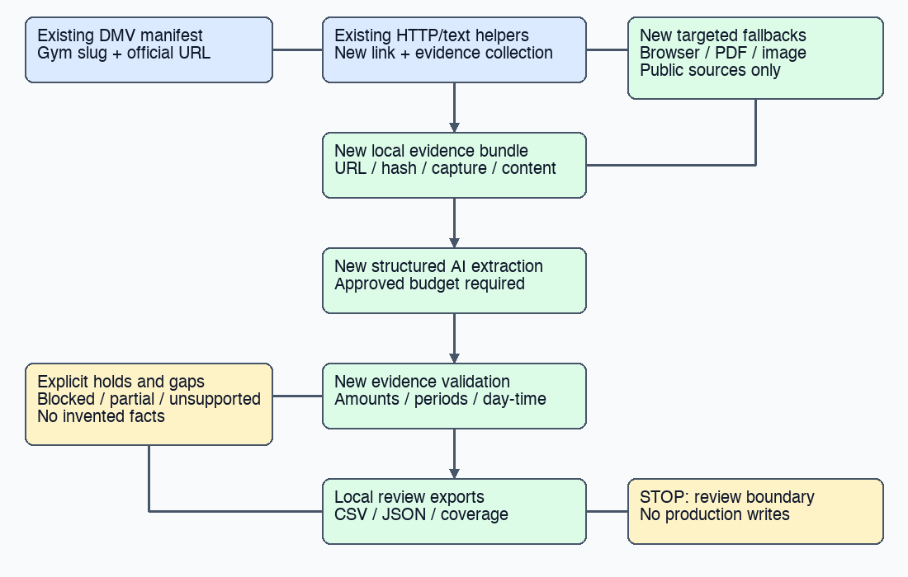
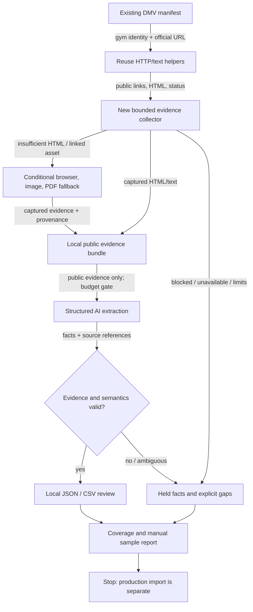

# website pricing and schedule extraction

Revision: v2 — approved by Vinh on November 2, 2026 ("approved"); 102 DMV gyms and up to $10 total paid AI API spending. Requirements preserved; execution evidence follows.
Project: FightGyms (`vnguyendc/fightgyms`). PR target: `master`.
Workspace: current `fightgyms-phone-prices/fightgyms` checkout, clean before planning, detached at `783e1c2ad485df857e71a4f60337c62ab210f0db`. Proposed branch after approval: `codex/website-pricing-schedules`. Refresh master and preserve any concurrent work before implementation.

## problem

Gym searchers need reliable prices and usable class schedules. Our existing AI extractor misses material that gyms publish outside ordinary HTML text and can accept unsupported output. Rerunning it unchanged would repeat coverage gaps and risk misleading prices or partial schedules.

Confirmed from `scrapers/extract_site.py` and local diagnostics on November 2:
- HTTP-only HTML fetch; no rendered DOM, iframe, image or PDF extraction. Internal links are followed by URL keywords, not link text. Hash-only links are ignored, and query parameters are discarded by href matching/page identity. External booking-provider pages are never followed; only a provider-name hint is retained.
- Maximum 12 successfully parsed pages, 20,000 characters/page and 200,000 characters/corpus. These bounds do not bound all failed requests; truncation loses context.
- Prompt collapses adult membership tiers to a lowest monthly price; schema has no weekly/four-week interval or explicit age/program coverage. Validation keeps one lowest row per kind and drops youth/family tiers entirely.
- A synthetic local reproduction accepted $169.42 against source text stating $169.99 with a fabricated quote. It also accepted `99:99` as a class start. Price validation checks only the integer portion somewhere on a page; schedule validation checks a time-shaped string and page existence.
- Normal extraction mode writes prices and replaces classes. `--dry-run` prevents those writes, but still reads the database and uses a paid model. Existing sources retain extracted output and page URLs, not the complete captured text advertised in the module description.

Read-only live checks: Brunswick FAQ exposes $140 kids / $160 adults in HTML; Mantis exposes `#schedule` and official Gymdesk links; TITLE Columbia returns HTTP 200 but zero extractable text. A probe of `www.1upmuaythai.com` returned 404: retain that failure rather than guessing another hostname. The outreach manifest contains 102 gym listings, 100 with researched/original website URLs, 97 exact unique URL strings; reconcile and deduplicate canonical sites without merging branch identities. These are manifest counts, not current database totals.

## solution and visual overview

Add a review-only website-audit command that reuses useful HTTP/text helpers and the existing Anthropic client pattern. Collect richer public evidence, extract all relevant plan and schedule facts without flattening them, and validate each fact against its source. Produce local evidence, CSV/JSON and a coverage report. Do not route the new runner through the existing database-writing process.

Caption: existing manifest and HTTP extraction feed a new review pipeline. Browser/document fallbacks are conditional. Unsupported evidence becomes a visible gap; validated facts go to local review files, with no production write path. Blue denotes existing inputs/helpers, green new behavior, amber explicit limits/holds. Editable diagram source:

## context and triage

Classification: feature plus extraction-correctness fixes; normal urgency, meaningful data-integrity risk. No website UI, schema, migration or production change. Existing extractor regressions are confirmed locally; published content accessibility varies by site. No paid model call or database mutation occurred during planning.

User-selected scope and budget: the existing 102 DMV listings, including explicit no-website results, with a 10-gym pilot before the remainder and a hard $10 total paid AI API ceiling across pilot, retries and full run. Do not silently expand to the whole directory. This scope/budget selection does not by itself approve implementation of the planning document.

Dependencies: Python 3.12 (CI), existing HTTP/text/Anthropic libraries. A key is configured in the main checkout's existing `.env`, but not in the current process; credentials have not been printed or tested. Availability does not authorize spending. Prefer the configured provider, with model capability/schema compatibility verified in a tiny pilot. Browser fallback uses existing supported CUA tooling during this task; a standalone automated-browser dependency is not required for v1. The CLI accepts captured public evidence so browser fallbacks remain resumable and reproducible. Document/image processing can use the same provider's PDF/vision support where model-compatible and budget-authorized; otherwise record an explicit unresolved asset.

Research: repository README, extractor, DB helper and extraction/shadow tests, scraper/web CI, existing phone import plan; public outreach manifest and prior local pricing-review artifact. Current primary references: [PDF input](https://platform.claude.com/docs/en/build-with-claude/pdf-support), [image input](https://platform.claude.com/docs/en/build-with-claude/vision), [frame behavior](https://playwright.dev/python/docs/frames). The proposed tools can process these input types; this is not evidence that every gym widget is accessible.

Stewardship: Linear search for FightGyms returned no match; no new corporate issue proposed. Obsidian MCP is unauthorized; located and read the real vault project note `01 Projects/FightGyms.md` via filesystem fallback. It contains historical conflicting deployment statements, so use current repository/chat evidence for this task. No wiki/Linear writes proposed: local plan and future PR are the canonical records, and user has not requested a wiki update. Do not copy private email bodies into the public evidence bundle or Git. Prior discovery memory reinforced official-site evidence and held relocation/identity cases; current code and public checks establish this plan's findings.

Exclusions: email outreach, forms, bookings, login/CAPTCHA circumvention, private customer data, photo/social ingestion, Jev changes, coaches/fighters, automatic publishing, schedule replacement, import adapters, schema/UI changes, merge/deploy. Preserve the approved free-trial indexing rule.

## requirements and acceptance criteria

| ID | Requirement and observable acceptance |
|---|---|
| R1 | Read an explicit manifest with stable gym slug/branch identity and official URL. Account for every selected listing, including absent URLs. Deduplicate downloads while retaining per-branch holds; redirects/rebrands never silently transfer facts between locations. |
| R2 | Discover relevant pages using anchor text and URL, including FAQ, pricing, membership, timetable and class schedule; retain meaningful query parameters and fragments in evidence identity. Follow linked public document/image and gym-linked provider evidence only. Bound attempts, redirects, bytes, corpus size and time; record reached limits. |
| R3 | HTTP first, then targeted rendered-page/tab/frame captures and PDF/image interpretation when needed. Keep requested/final URLs, capture timestamp, content hash, extraction mode, text or local asset, and parent link evidence. Readable public-only browsing; no submissions or authenticated content. Unsupported or blocked assets remain gaps. |
| R4 | Retain individual prices with exact USD amount, billing interval/count, plan, style, audience, class limits, minimum term, cancellation, fees, trial eligibility and promotion conditions when stated. Preserve unknowns. Do not convert weekly/four-week totals into monthly prices or classify private/youth/intro rates as standard adult membership. Free trials remain $0 facts. |
| R5 | Class facts retain day, valid local start/end, class name, style, level/audience, location and timezone/effective dates only when supported. Distinguish recurring timetable from dated events, opening hours, appointments and incomplete schedules. Never invent AM/PM, duration, recurrence or timezone. |
| R6 | Each fact has a source ID and supporting excerpt; PDF/image facts also reference page/crop/asset. Validate exact amounts and semantic context, not integer occurrence elsewhere. Reject nonfinite/boolean amounts, invalid clock times and unsupported provenance. Conflicting dates/branches or ambiguous source interpretation become held review items. Vision/OCR output requires visual sample verification; text matching alone cannot certify it. |
| R7 | Per-gym pricing and schedule coverage separately distinguishes found, partial, not-found-in-reviewed-evidence, blocked, fetch-failed, extraction-failed, budget-deferred and no-website. Do not claim content is unpublished without sufficient evidence. An error cannot be counted as a successful empty extraction. |
| R8 | New command is local-output-only and runs without DATABASE_URL. Default collection makes no paid AI call. Approved model calls enforce a user-selected run-wide USD ceiling with conservative pre-call reservation, token/output limits, retries included, persisted usage and stop-before-exceeding behavior. Unknown pricing or missing credentials blocks paid extraction, not evidence collection. Resume caches unchanged evidence/model/prompt versions; explicit refresh preserves history. |
| R9 | Produce JSONL facts/evidence, price/class CSVs, per-listing coverage and summary, plus manual-review findings. Raw runs and private outreach files stay outside Git. Preserve incompatible facts for review instead of coercing into current DB price kinds. |
| R10 | Independently inspect 10 pilot gyms spanning static text, dynamic/widget, image/PDF when present, missing/blocked and multiple branches. Check all accepted pilot prices and schedule entries plus missed-source review. Report field precision and source coverage with denominators; source availability is not a pass criterion. No unsupported critical amount, interval, audience or day/time may advance without correction and affected recheck. Audit a deterministic stratified sample from the remainder, at least 10 gyms or all remaining if fewer. |
| R11 | No production writes, no public site change and no destructive schedule handling. Verify runner can execute with DB functions unavailable and no DB credentials. Legacy extract/shadow tests continue passing; no automatic use of the legacy writing path. |

## design

Use a small review runner (`scrapers/audit_sites.py`) with narrowly scoped collector/evidence helpers under `scrapers/common/` as needed. Avoid rewriting the legacy pipeline. Share only proven pure helpers; if strengthening legacy validation affects its contract, cover the change with regression tests and retain its existing CLI and shadow semantics. Keep the richer review schema separate from current DB kinds.

Pipeline: manifest preflight → bounded HTTP/link collection → coverage-driven fallback queue → captured public evidence → structured extraction → deterministic validation/holds → local review exports. The prompt treats source material as untrusted data, ignores website instructions, requests exact evidence and explicitly preserves billing/audience/program distinctions. Do not allow the model to choose arbitrary fetch URLs or write destinations. Prefer semantic HTML parser link discovery over raw href regex.

Candidate limits: 12 HTML pages and at most 30 fetch attempts/gym, 20s/request, 5 redirects, 10MB/document, 5 relevant assets/gym, 200k text characters/gym, and at most 2 browser fallback pages/gym initially. Any clipping is reported as partial. Use a polite per-host delay, robots policy, low bounded concurrency and capped backoff; all redirects and discovered sources must be public HTTP(S), with local/private/reserved network targets blocked before requesting, including redirect hops. Follow only site-attested assets/providers and do not infer membership data from a login route.

Separate browser capture from core CLI: CUA reads visible public pages and saves evidence artifacts; the runner ingests those artifacts with source metadata. This avoids creating a second browser automation stack while enabling the requested run. Sites that still need unsupported interaction remain honest gaps, not fake completed schedules.

Schedule completeness is evidence metadata, not a model promise: record visible day/date range, location, truncation and inaccessible frames. Exports may contain partial classes for review but cannot be used for wholesale schedule replacement. Existing `replace_classes()` is never called.

Budget selected by user becomes a run parameter, not a hardcoded assumption. Record provider/model, prompt version, token usage and estimated charge. Reserve worst-case bounded request cost before each call and reconcile afterward. If credentials/budget are pending, deliver collector/offline evidence tests and identify the paid-run gap; do not call it a verified model extraction.

Alternatives: simply rerun legacy `--dry-run` is smaller but misses content types and retains unsafe normalization; rejected. Fully autonomous browser/vision crawling for every page raises cost and complexity; use targeted fallback. Automatic imports would conflate review with publishing and cannot safely represent every billing/program distinction; excluded.

## task breakdown

1. R1/R7/R8/R11: manifest loader, run ledger, outputs/cost policy and no-DB preflight; tests for missing sites, branches, replay and budget stop.
2. R2/R3/R7: HTTP/link collector, saved public corpus and fallback manifest; exercise real static, 404 and JS-shell cases plus synthetic redirect/query/fragment/PDF/image cases.
3. R4/R5/R6: richer schema/prompt and evidence validator; regression fixtures for exact cents, fabricated quotes, youth vs adult, private vs group, weekly vs four-week/monthly, valid times and incomplete schedules.
4. R8/R9: extraction driver, PDF/image support as needed, evidence imports, resume and JSON/CSV/coverage exports; deterministic offline provider fixtures for failure, truncation and accounting.
5. R3/R10: conduct 10-gym pilot with supported browser fallback; manually compare complete output against captured sources, fix all critical extraction errors and record missed-source review.
6. R1/R7/R10: run the remaining approved scope within the same total budget, record deferred sites explicitly, sample-check remainder and deliver a publishable-facts proposal with holds.
7. R11: self-review, independent behavioral verification against requirements, scraper regression suite, PR creation and observed CI/preview report. No merge or production import.

## validation and delivery

Implementation: focused tests derive from R1–R11, not snapshots of implementation; full `python -m unittest discover -s scrapers/tests -v`. Reproduce the exact cents/quote/time acceptance gaps and demonstrate rejection. Exercise CLI with saved synthetic evidence and absent DB/key, real public collection, paid pilot only after authority, resume without duplicate cost, stop at caps, partial/failed input reporting. Validate source references and compare original captured amounts/times, not the model's own summaries.

Verifier: inspect actual local CLI artifacts, independent source sample, coverage totals sum to selected manifest count, usage ledger fits the authorized cap, hold classifications, no private evidence in Git, no DB calls and no production mutations. If API/browser access fails, report the limitation and affected criteria; do not substitute fixture accuracy for real-site accuracy.

CI currently runs `Scraper tests / offline-tests` for scraper paths and `Web quality gates / web` on every PR (tests, typecheck, lint, build, HTTP smoke); Vercel normally creates a web preview. No web behavior is changed; identify the actual required check set at PR delivery. Do not add tests depending on paid APIs or live gym uptime to CI. Candidate changes repeat affected checks. PR targets master; merging would trigger production integration and remains separately authorized.

Approval state: Vinh approved v2 on November 2, 2026 with "approved", after selecting 102 DMV gyms and up to $10 total paid AI API spending. Implementation, verification, public-site collection, extraction within the $10 total ceiling and PR creation against master are authorized. No production imports, merges, deploys or wiki updates.

## execution evidence — November 2, 2026

G1 is approved. Implementation lives on `codex/website-pricing-schedules`, based on `783e1c2`. Added the review-only CLI, bounded public evidence collector and runbook; legacy extractor/database behavior is unchanged. No UI changes or tracker/wiki writes.

Self-review addressed exact-cent/quote/time validation, query/fragment discovery, shared-source duplication, irrelevant image budget use, no-site coverage, provider-auth stop behavior, cache/resume cost accounting, and DNS-rebinding protection. The transport pins a validated public IP while retaining original Host/SNI/certificate checks; no cross-host pooled connection reuse. No unresolved P0/P1 code findings were identified in the final local review. All extracted items remain review candidates; automated quote checks do not certify full semantics.

Local checks: 16 focused audit tests, full scraper suite, 116 web tests, typecheck, lint, backend-unconfigured production build and all HTTP smoke checks. Runtime: existing scraper virtualenv uses Python 3.14; CI Python 3.12 has not run because no PR is delivered. Focused live HTTPS/redirect probes passed with pinned transport. Existing fixture-suite SQLite ResourceWarnings remain unrelated to this task.

Operational run (outside Git): `/Users/vinhnguyen/.local/share/fightgyms/runs/dmv-website-2026-11-02`. All 102 entries accounted for: 90 with evidence, 10 fetch/content failures, 2 missing websites. 611 per-listing source references after deduplication: 582 HTML, 23 images, 4 PDF, 2 browser. Browser source review confirmed Mantis weekly schedule and TITLE Columbia pricing omitted by HTTP extraction. `manual-source-review.md` records all 10 pilot source observations, not model accuracy.

Provider preflight: configured Anthropic credential returned AuthenticationError from count_tokens, before any billable extraction call. $0 spent by this run. User was asked to configure a working key securely; no credential values or provider response bodies were printed. Paid extraction and real-model accuracy verification are blocked. No production import, merge, deploy, push or PR was performed.

Verifier reassessment (same assistant, no separate reviewer):

| Requirements | Observed coverage | Status |
|---|---|---|
| R1 | Full manifest and local CLI outputs cover 102 unique slugs; absent sites retained | pass for collection |
| R2–R3 | HTTP/link/assets captured; robots/network/token limits tested; public rendered evidence saved for two pilot sites | partial; remaining targeted fallback/AI interpretation pending |
| R4–R6 | Synthetic regression cases reject unsupported prices/times and hold ambiguous/image facts | model behavior unverified; no real extraction output |
| R7 | Separate price/schedule coverage totals sum to 102; missing/failed/deferred states remain explicit | pass for collection/deferred run |
| R8 | No-key/default CLI, pessimistic budget reservations, timeout retention and cached paid-call replay tested; actual auth rejection spent $0 | partial; successful provider path not exercised |
| R9 | Evidence JSONL, CSV headers, per-gym report and raw capture bundles written/reloaded outside Git | partial; fact exports lack real-model rows |
| R10 | Ten source checks saved; 0 model facts available for precision/recall denominators | blocked; pilot and remainder accuracy acceptance not passed |
| R11 | No DB adapter import/apply path; real no-DB CLI test and collection run; legacy suites pass | pass locally |

Current stage: verifier blocked on external authentication. Do not deliver a verified/ready PR until the pilot and remaining approved run can be extracted and checked. Next: user supplies a valid credential securely, resume the same run/budget, compare all pilot output with sources, fix/reverify affected behavior, complete remainder plus sampled review, then create PR to master. No new implementation approval is needed within this scope.

## authorized provider adjustment — November 2

Vinh explicitly instructed: "let's use our OPENROUTER_API_KEY" after the direct Anthropic authentication blocker. This authorizes the provider change within the same 102-gym/$10 review-only scope; no additional planning gate. Keep Haiku 4.5 via OpenRouter, restrict routing to Anthropic with no fallback, verify the live model context/pricing/capabilities, use native PDF input (no paid OCR plugin), and reconcile actual OpenRouter usage cost. Include provider/model/output limit in cache fingerprints and reserve the full model context plus the bounded output before every call. Increase output allowance to 16k tokens to avoid dropping longer schedules. No email contents enter the public-site extraction API. Existing approval and production restrictions stand.

## final OpenRouter verification — November 2, 2026

This supersedes the authentication-blocked execution status above. The approved OpenRouter adjustment completed the same 102-listing run. No private email content entered model requests. All run artifacts remain outside Git.

Observed final runtime: 98 listings with evidence, 622 source references; 89 price candidates, 279 class candidates, 1,421 held facts. Both coverage totals account for 102: 95 partial, 2 extraction_failed (malformed model arrays), 1 not_found_in_reviewed_evidence, 2 fetch_failed, 2 no_website. Partial includes held facts and inaccessible widgets and is not a complete schedule certification.

OpenRouter reported $2.679630 actual usage; $0.96 remains reserved for two failed requests with unknown billed outcome, totaling $3.639630 used/reserved against $10. Correct MIME identification recovered Lotus's PNG mislabeled JPEG. Final full CLI replay reused successful cached model responses with unchanged spend. No automatic retries or production writes.

Source sample review: all 38 retained pilot facts (16 prices, 22 classes) plus 105 retained facts from ten stratified remainder listings (14 prices, 91 classes) compared with original captured sources. No critical amount/interval/day/start errors remain in these sampled candidates after fixes. This is retained-candidate precision with a stated denominator, not overall raw model accuracy or full-site recall. Same assistant performed implementation and source review; no separate reviewer was used. Image/PDF proposals remain held, not certified by text matching. Source absence, inaccessible calendars, missed BETA/Brunswick free trials, seasonal Yamasaki entries, and branch ambiguity remain explicit coverage gaps.

Corrections verified: old camp offers, dated/alternating events, ambiguous package totals and invalid age-as-date fields are held; starting-at and introductory rates carry explicit qualifiers. Quote recovery binds the class name to its actual time row under a weekday header rather than accepting a nearby time. Exact cents, explicit billing interval, unknown audience, branch attestations, transport security and no-DB restrictions remain enforced.

| Requirement | Final behavior and evidence | Result |
|---|---|---|
| R1 | 102 stable manifest identities; separate branch records, two absent URLs, redirect identity holds | pass |
| R2–R3 | Bounded real public HTTP collection, 13 browser captures across 10 gyms, original image/PDF bytes and source hashes; inaccessible content reported | pass; coverage partial by site |
| R4–R6 | 143 sampled retained facts source-checked; exact semantic restrictions tested, visual and ambiguous facts held | pass for review-only extraction; no full-corpus accuracy claim |
| R7 | Separate coverage state totals each sum to 102; failures never successful empty results | pass |
| R8 | Actual OpenRouter requests, persistent conservative cost ledger, final no-spend cached replay, concurrent reservation and stop tests | pass |
| R9 | Nonempty JSONL/CSV and summary/report/manual-review artifacts reloaded outside Git | pass |
| R10 | Ten pilot plus ten deterministic stratified remainder listings; 38 + 105 retained facts checked, missed/held cases disclosed | pass; no independent agent reviewer |
| R11 | Real local CLI never imports DB adapter or writes production; full legacy suite remains green | pass |

Final local scraper tests: 125 passed, including 28 audit/provider tests. Existing Python SQLite ResourceWarnings are unrelated. Previous 116 web tests, typecheck, lint, sample-data production build and HTTP smoke remain applicable because no web/build/config files changed. CI Python 3.12 and PR preview are delivery checks, pending PR creation. No UI code change.

Delivery preflight: PR to master; push task branch and normal CI/preview only. Monitor individual scraper/web/Vercel checks for up to ten minutes; no branch protection rule found (API 404). The changed interface is an offline/operator CLI, so real local paid-run/replay is its runtime evidence; web preview does not execute this tool. Recovery is withholding import and reverting the task branch if needed; production has not changed. No merge, auto-merge, deployment or import authorized for this change. Remaining P2/P3 data limitations: incomplete source coverage, held visual output, two malformed extraction responses, no whole-corpus semantic certification. No unresolved P0/P1 code finding from final self-review.

Delivery review follow-up: automated PR review found that empty/whitespace/comment-only HTTP 200 HTML could raise ParserError and abort manifest collection. Discovery now returns no links for parser-empty documents; collection retains the source and rendered-content fallback, so coverage stays partial and other gyms continue. Regression exercises the collector and coverage path for all three inputs. Final local suite: 126 passed. No paid-run data or model fingerprint changed. Branch rules API confirms required web and Vercel checks (classic protection 404 alone was incomplete evidence). Repeat CI on the follow-up candidate; no merge.
